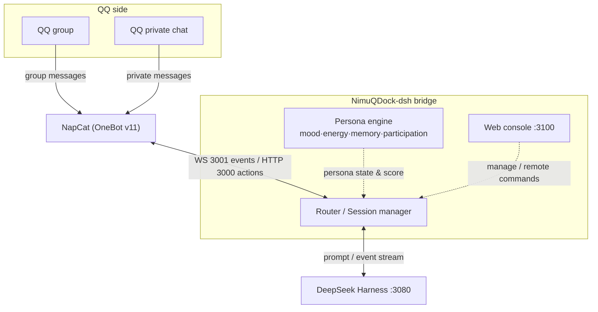
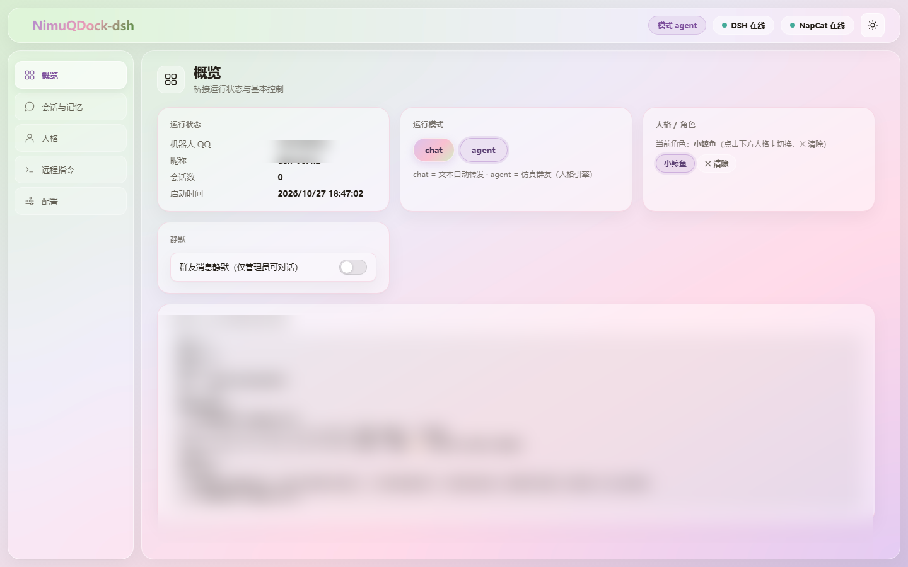
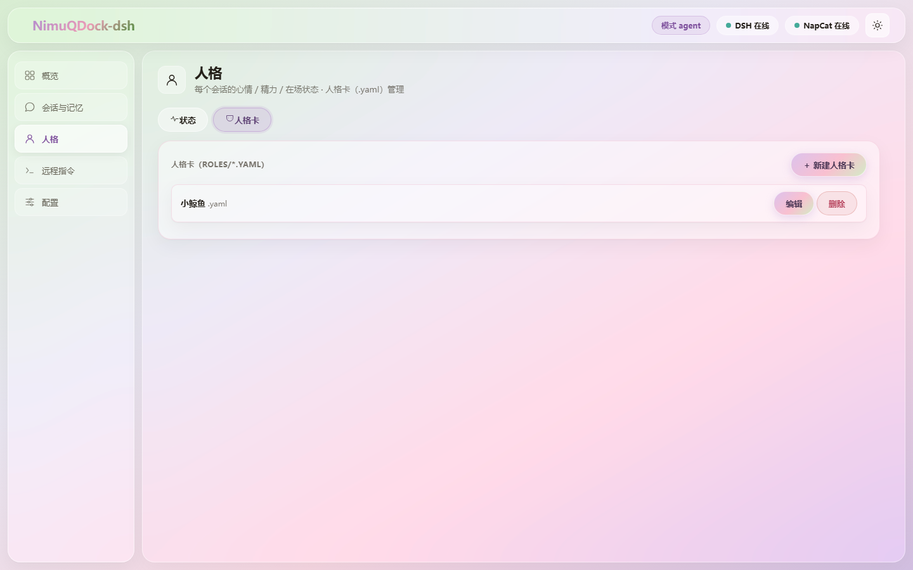
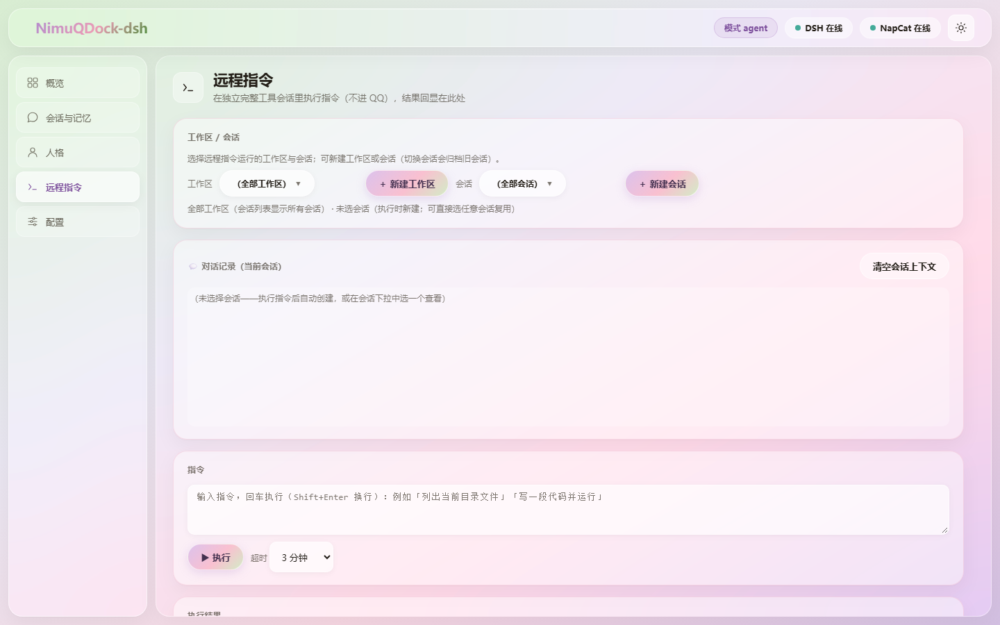

<div align="center">


**Beauty is the craft**

# 🔌 NimuQDock-dsh

**Dock DeepSeek Harness AI into QQ · A simulated group friend powered by a persona engine — with mood, energy and memory, it dives low and joins in like a real person**

[](https://github.com/NimuStudio/NimuQDock-dsh)
[](https://github.com/NimuStudio/NimuQDock-dsh/blob/main/LICENSE)
[](https://nodejs.org)
[](https://github.com/deepseek-ai/deepseek-harness)
[](https://github.com/NapNeko/NapCatQQ)

[**中文**](README.md) · [**English**](README.en.md) · [Contributing](CONTRIBUTING.md) · [Security](SECURITY.md) · [Changelog](CHANGELOG.md)

</div>

> Maintained by [Nimu Studio](https://nimustudio.cn)

---

## Table of contents

- [Download](#download)
- [What is this](#what-is-this)
- [Architecture](#architecture)
- [Screenshots](#screenshots)
- [Features](#features)
- [System requirements](#system-requirements)
- [Compatibility](#compatibility)
- [One-click install (Windows)](#one-click-install-windows)
- [Uninstall](#uninstall)
- [Getting started](#getting-started)
- [Troubleshooting](#troubleshooting)
- [Known limitations](#known-limitations)
- [Feature matrix](#feature-matrix)
- [Project structure](#project-structure)
- [Discussion](#discussion)
- [Ecosystem](#ecosystem)
- [Supporters](#supporters)
- [Support](#support)
- [Contributing & security reports](#contributing--security-reports)
- [Data & privacy](#data--privacy)
- [Usage notes](#usage-notes)
- [License & third parties](#license--third-parties)
- [Contact](#contact)

## Download

| Way | Link | Notes |
|---|---|---|
| **exe (graphical installer, ~26–30 MB)** | [GitHub Releases](https://github.com/NimuStudio/NimuQDock-dsh/releases/latest) | Detects local components, lets you tick DSH / NapCat / judge model |
| **CN mirror** (recommended in mainland China) | [gh-proxy direct link](https://gh-proxy.com/https://github.com/NimuStudio/NimuQDock-dsh/releases/latest/download/NimuQDock-dsh-latest-setup.exe) | Fixed filename, always points at the latest build |
| **zip full offline bundle** | Assets on the Releases page | Full offline bundle (inference engine and judge model included — see that release's assets and notes for what is actually inside), unzip and run |

> When the installer downloads NapCat, the inference engine or the judge model it uses CN mirrors automatically; only the exe itself needs the accelerated link above.
> Everything is installed inside the install directory — uninstalling means deleting that directory.

## What is this

NimuQDock-dsh invites DeepSeek Harness agents into QQ groups and private chats: when someone speaks in a group, it can hear; when it wants to speak up, its reply lands right in the chat. On top of that, the **persona engine** keeps it from being an always-answering customer bot — instead it's a **simulated group friend** with a mood, an energy level, a memory, and a habit of going quiet or bubbling up like a real person.

The journey of a single message:

```
① Someone speaks in QQ (reported by NapCat over the OneBot v11 protocol)
        │
        ▼
② The bridge feeds the message into the matching DSH session
        │
        ▼
③ The agent thinks it through: a reply / a question / a tool approval
        │
        ▼
④ The result goes back to QQ (chat mode replies automatically; agent mode lets the AI send and receive on its own via tools)
```

> In **chat** mode, steps ①–④ run fully automatically. In **agent** mode, the AI reads messages by itself, decides whether to reply, and picks which topics to jump into.

## Architecture



- **QQ side**: NapCat speaks the QQ protocol and reports group/private messages over OneBot v11
- **Bridge process**: routes each message into the matching DSH session; the agent's replies (including questions and tool approvals) go back to QQ
- **Persona engine** (agent mode): computes participation from mood/energy/memory to decide whether to join in
- **Web console**: local management UI — switch modes, tune the persona, manage whitelists, issue remote commands

## Screenshots

| Web console overview | Persona state (agent mode) |
|---|---|
|  |  |

| Remote command panel |
|---|
|  |

> QQ numbers / group IDs in the screenshots are masked.

## Features

- 🧠 **Persona engine**: mood / energy / relationships evolve with every interaction — getting roasted lowers mood, chatting more deepens bonds, low energy makes it lurk
- 🎯 **Participation model**: not "reply to everything" — a score combining「how directly addressed + topic interest + energy + mood + random noise」must clear a threshold before it joins in; @mentions and direct questions are always answered, casual chatter depends on its state
- 💾 **Layered memory**: rolling group-topic statistics + long-term memory (impressions of group members, unfinished topics), injected by relevance
- 🛡️ **Safety boundary**: QQ sessions physically have no local tools, sending is force-whitelisted, replies containing sensitive info are blocked entirely, and web search ships with SSRF protection
- 🎛️ **Web console** (glassmorphism UI): visualize and tune persona state, manage whitelists, manage persona cards, remote command panel (full-tool session), memory / logs / sessions
- 🚀 **Remote command panel**: sign in to the console and let DSH's full tools (pwsh / files / etc.) run tasks with results echoed back — never touching the QQ transport layer

## System requirements

| Item | Requirement | Notes |
|---|---|---|
| OS | Windows 10 / 11 (x64) | The installer (NSIS) and `start.bat` target Windows only; macOS / Linux can run from source but are unverified |
| Node.js | **≥ 22.13** | Hard requirement in `package.json` `engines`; older versions abort at startup. The exe / zip bundles ship Node, running from source does not |
| QQ client | QQNT client installed | The NapCat Shell build works by injecting into the QQ process, so the official client is mandatory |
| DeepSeek Harness | 0.2.1-rc.5 (pinned) | DSH must be running and reachable locally; its address goes into `dsh.baseUrl` in `config.json` |
| Memory | No hard floor (this project has no memory benchmark) | Text chat just needs DSH + bridge + NapCat to fit together; leave extra room if you enable the 1.7B judge model |
| Disk | No hard floor, grows with the components you tick | Judge model 0.6B ≈ 379 MB / 1.7B ≈ 1.1 GB, CPU inference engine ≈ 23 MB, full offline bundle ≈ 410 MB — all inside the install directory |
| GPU | **Not required** | The bundled CPU `llama-server` handles the participation judge (measured ≈ 100–200 ms per decision); with an NVIDIA card point `judge.llamaServer` at your own CUDA build for faster judging |

## Compatibility

The bridge does **not** parse a version string: it probes the API shape at startup and adapts to both DSH protocol generations (0.1.x and 0.2.x). The startup log prints `DSH 协议：0.2.x` or `0.1.x`.

| Component | Support | Notes |
|---|---|---|
| DeepSeek Harness 0.1.x | Supported (auto-adapting) | Uses `/api/<ns>.<method>` + `/api/events.mux`; 0.1.1 has no persisted secret, so it degrades to no auth |
| DeepSeek Harness 0.2.x | Supported (auto-adapting) | Uses `/api/<ns>/<method>` + `/api/remote.mux` |
| **Tested DSH version** | **0.2.1-rc.5** | The pinned value (the installer installs this version too); other versions may work, but combinations other than 0.2.1-rc.5 are untested |
| NapCat | OneBot v11 (forward WebSocket + HTTP actions) | No NapCat version is pinned; use the Shell build on Windows (needs QQNT), the Docker image on Linux |
| QQ client | QQNT | Follows upstream releases; not pinned here |
| Local judge model (optional) | llama.cpp + Qwen3 0.6B / 1.7B GGUF | Apache-2.0; a CPU inference engine ships by default |

Default ports (all bound to `127.0.0.1` only):

| Port | Purpose | Config key / basis |
|---|---|---|
| 3080 | DSH web (default) | `dsh.baseUrl` in `config.example.json`; change it if DSH listens elsewhere (the dev machine ran an independent instance on 3090) |
| 3100 | Bridge web console | `console.port` in `config.example.json` |
| 3001 | NapCat WebSocket server | `napcat.wsUrl` in `config.example.json` |
| 3000 | NapCat HTTP server (default) | `napcat.httpUrl` in `config.example.json` |
| 3005 | NapCat HTTP server (fallback when 3000 is taken) | `pickPort` in `start.mjs`; auto-install writes the chosen port back into `config.json` |
| 8080 | Local judge model `llama-server` (optional) | `judge.url` in `config.example.json` |
| 6099 | NapCat WebUI | Provided by NapCat, unrelated to the bridge |

> The defaults above come from `config.example.json`; your `config.json` and the startup log are authoritative. When a port is taken, the auto-installer picks a free one and writes it back.

## One-click install (Windows)

Grab a package from [Releases](https://github.com/NimuStudio/NimuQDock-dsh/releases/latest) (all dependencies included, no `npm install` needed):

| Way | Size | Steps |
|---|---|---|
| **exe installer wizard (recommended)** | ~26–30 MB | double-click → tick components (app / DSH / NapCat / judge model) → pick a folder → install → launch from the finish page |
| **zip offline bundle** | ~410 MB | unzip → double-click `start.bat` (full offline bundle with the inference engine and judge model; see that release's assets and notes for what is actually inside) |

The wizard detects components already on the machine (already-installed ones are greyed out), downloads over CN mirrors, and supports resumable transfers plus SHA256 verification.
You only have two manual steps: **① install the QQ client ② scan the QR code and configure OneBot11**, then start it and open the web console.

> Release bundles ship Node.js; running from source needs Node.js ≥ 22.13 and an installed QQ client.

## Uninstall

- **exe installs**: uninstall from Windows "Settings → Apps", or run `uninstall.exe` inside the install directory.
- **zip / source users**: double-click `uninstall.bat` in the project.
- Uninstalling first stops a running bridge and the NapCat injection process, then removes the install directory.
- Before removing anything it backs up `state/` (memory, logs) and `config.json` to `Documents\NimuQDock-dsh-backup`; restore manually if needed.

## Getting started

### Prerequisites

| Dependency | Notes |
|---|---|
| Node.js | ≥ 22.13 |
| DeepSeek Harness | see "Install DeepSeek Harness (DSH)" below |
| NapCat | QQ protocol implementation, [download](https://github.com/NapNeko/NapCatQQ/releases/latest) |
| QQ account | one dedicated for the bot (an alt account is recommended) |

### Install DeepSeek Harness (DSH)

The AI runs inside [DeepSeek Harness](https://github.com/deepseek-ai/deepseek-harness), so start it first:

```bash
# Option 1: run on the fly (good for a quick try)
npx @deepseek-ai/dsh web

# Option 2: install globally, then run
npm i -g @deepseek-ai/dsh
dsh web
```

Opening `http://127.0.0.1:3080` in a browser and seeing the DSH UI means it's up. The URL/port is configured in `config.json` under `dsh.baseUrl` (default `http://127.0.0.1:3080`) — keep the two in sync if you change it.

### ① Install dependencies

```bash
npm install
```

### ② Bring NapCat online

> **Which build**: on **Windows** use the **Shell build** (a QQNT client must be installed first; QR-code login). On a **Linux server** use the **Docker image** (it bundles a Linux QQ). The steps below use the Windows Shell build as an example.

1. Download NapCat and follow its official guide to log in with your QQ account (QR-code login; a QQ client must be installed).
2. Open the NapCat WebUI: `http://127.0.0.1:6099/webui` (default password `napcat`).
3. Go to **Network config** and create two connections, with **message format set to `array`** for both:
   - **HTTP server**: `127.0.0.1:3000` (any free port works; if 3000 is taken, pick another free port — 3005 for example — and change `napcat.httpUrl` in `config.json` to match; the `start.bat` auto-install does this for you)
   - **WebSocket server**: `127.0.0.1:3001`
4. If you set an accessToken in the WebUI, note it down and put it into `config.json` next; leaving both empty also works, but they must match.

> With the `start.bat` auto-install you do not need this step by hand: the bridge generates `onebot11_<botQQ>.json` and avoids occupied ports. The effective ports are `napcat.wsUrl` / `httpUrl` in `config.json`.

The generated OneBot11 config lives at `config/onebot11_<botQQ>.json` in the NapCat directory.

> **Using your own QQ**: NapCat has to relaunch QQ in order to inject, so starting the bot logs your currently signed-in QQ out.
> To use both at once, give the bot its own QQ copy (duplicating the existing QQ install directory is enough), then set
> `"napcat": { "qqPath": "D:\\QQ-bot\\QQ.exe" }` in `config.json` — `start.bat` prefers that path and your own QQ stays untouched.
>
> Note: the same bot QQ account **cannot** be logged in on two machines at once — that triggers risk-control kicks (see "Known limitations").

### Participation judge: rules / local model (optional)

In agent mode there are two ways to decide "should this message be picked up"; the bridge picks one automatically:

| Mode | Condition | Notes |
|---|---|---|
| **Rules** (default) | no model installed | scores signals such as @mention / quote / second person / question / cooldown / consecutive pickups |
| **Local model** | llama-server + GGUF detected | a small model judges whether it is being addressed; context signals still fall back to rules |

- Model: [Qwen3-1.7B Q4_K_M](https://www.modelscope.cn/models/unsloth/Qwen3-1.7B-GGUF) (≈ 1.1 GB, Apache-2.0; measured 20/20, ≈ 200 ms per decision)
  - Lighter option: `npm run fetch-judge -- --small` switches to 0.6B (≈ 379 MB, runs on CPU)
- Inference: `llama-server` from [llama.cpp](https://github.com/ggml-org/llama.cpp) (the release bundle ships a CPU build, ≈ 23 MB)
- Install: `npm run fetch-judge` (1.7B by default; add `-- --small` for 0.6B; models go to `models/`, inference to `llama/`)
  - The release bundle ships 0.6B per the build pipeline (check that release's assets); for better accuracy double-click `install-model.bat` to upgrade to 1.7B (≈ 1.1 GB)
- Auto fallback: when the model is missing, startup times out or output is malformed, it **falls back to rules** and chat is unaffected
- chat mode: no judging at all, every message goes straight to DSH

Related `config.json` block:

```json
"judge": {
  "enabled": "auto",          // auto | on | off
  "url": "http://127.0.0.1:8080",
  "modelPath": "",            // empty = first .gguf under models/
  "llamaServer": "",          // empty = llama/llama-server.exe; point at your own CUDA build for NVIDIA
  "timeoutMs": 2500
}
```

#### Train your own judge (optional, advanced)

The bridge appends every decision to `state/judge-decisions.jsonl` (message text only, sanitised). After a while:

```bash
npm run export-judge     # exports dataset/judge-train.jsonl (balanced, de-duplicated)
npm run train-judge      # LoRA fine-tune of Qwen3-0.6B (needs Python + torch/peft/datasets)
```

The result must be merged with the adapter and converted to GGUF before llama.cpp can use it (the script header has the full procedure).
No GPU needed: the CPU build of llama.cpp ships with the project, judging is just slower (≈ 100–200 ms per decision).

### ③ Fill in config.json

```bash
copy config.example.json config.json
```

Key fields:

| Field | Description |
|---|---|
| `dsh.baseUrl` | DSH web service URL, default `http://127.0.0.1:3080` |
| `dsh.provider` / `dsh.model` / `dsh.reasoningEffort` | model provider / model name / reasoning effort (`off`/`low`/`high`/`max`); if your DSH lacks the example model, pick one available in the DSH settings page. **Slow replies? lower the reasoning effort** (`low` is 30–45% faster than `max`, fine for casual chat) |
| `napcat.wsUrl` | NapCat WebSocket server URL, default `ws://127.0.0.1:3001` |
| `napcat.httpUrl` | NapCat HTTP server URL, default `http://127.0.0.1:3000`; auto-install switches to a free port and writes it back here when 3000 is taken (**do not use the WS port**) |
| `napcat.qqPath` | QQ executable used by the bot (empty = auto-detect). NapCat restarts QQ when injecting, so a separate QQ copy keeps your own client open |
| `napcat.accessToken` | must match the accessToken set in the WebUI; leave empty if unset |
| `ownerQQ` | admin QQ number (agent-mode private wake-up, admin actions, etc.) |
| `agentPreset` | DSH agent preset used in chat mode, default `qq-chat` |
| `agentPresetAgent` | DSH agent preset used in agent mode, default `qq-agent` |
| `workspaceTitle` | group name for QQ sessions in the DSH UI, default 「QQ 聊天」 |
| `allow.private` / `allow.groups` | private / group whitelists (arrays of QQ numbers / group IDs), **recommended to fill in first** |
| `deny.private` / `deny.groups` | blacklists, take priority over whitelists |
| `allowAllWhenEmpty` | allow everyone when the whitelist is empty, default `false` (keep it) |
| `ackMessage` | instant acknowledgement text on receiving a message; empty string disables |
| `sendDelayMs` | interval between consecutive QQ sends, to avoid rate limiting |
| `maxReplyChars` | max chars per agent reply, longer replies are split automatically |
| `console.port` / `console.token` | web console port (default `3100`) and access token; if token is empty it is auto-generated and printed at startup |
| `security.interceptNotify` | whether to notify when a reply is blocked by the sensitive-content filter |
| `vision.enabled` / `vision.maxImageBytes` | image-understanding switch and size cap (needs a vision model) |
| `queue.maxPerSession` | max queued messages per session while DSH is offline |
| `social.*` | persona engine tuning (default persona, participation weights, heartbeat, memory, topics) — defaults are fine |

> With an empty whitelist and `allowAllWhenEmpty` set to `false`, the bridge **replies to nobody** — that is the default safe posture.
> `config.json` holds real QQ numbers / group IDs / NapCat accessToken: **never share it, screenshot it or commit it** (it is not tracked by git).

### ④ Install presets and MCP into DSH

```bash
node scripts/setup-dsh.mjs
```

The script installs the `qq-chat` / `qq-agent` agent presets, two MCP servers (safe QQ tools + web search), and a settings-page plugin into the DSH environment, and writes a local `state/mode.json` fallback. It is idempotent; **re-run it after moving the project directory** (MCP/plugin paths are absolute). **Restart DSH** afterwards for it to take effect.

### ⑤ Start

```bash
npm start
# or double-click start.bat (watchdog mode: auto-restarts 5s after a crash)
```

Success looks like the log showing `配置已加载` → `DSH 已连接` → `NapCat 已连接` → `桥接已启动` in order.

> Note: only one bridge instance may run (single-instance lock). If you see 「已有实例在运行」, double-click `restart.bat` or delete `state/bridge.lock`.

### Verify & daily use

- **Private-message** the bot or **@ it in a group** and see if it replies.
- Open the web console at `http://127.0.0.1:3100` (token printed at startup): check status, switch **chat / agent** mode, tune the persona, manage whitelists, issue remote commands.
- **agent** mode = simulated group friend: the AI watches messages on its own and decides whether to join based on its persona; private chats in agent mode only respond to `ownerQQ`.
- Restarting DSH does not require restarting the bridge: the bridge probes DSH automatically, queues messages while DSH is offline, and replays them once it recovers.

### Configure persona cards (roleplay)

- In the console under **🧠 Persona → Persona cards**, you can **create / edit** `roles/*.yaml`: one file = one complete persona, and saving takes effect immediately (the cache is cleared automatically).
  The `prompt` field is the persona text (identity, speech style, pet peeves injected into the AI); the other fields (mood / energy / interests / proactiveness) drive the persona engine.
- **chat mode** role switch: in the console under **📊 Overview → Persona / role**, click a persona card (group members cannot change it).
- **agent mode** default persona: edit `social.defaultPersona` in `config.json` (e.g. `小鲸鱼`), save, and restart the bridge.

### Offline self-tests (no QQ needed)

```bash
npm run self-test        # bridge ↔ DSH connection link
npm run test-loop        # chat loop (real DSH + fake QQ)
npm run test-loop -- --mode agent   # agent loop (wake / dive)
npm run test-persona     # persona engine unit tests
npm run test-agent-api   # agent internal API
npm run test-mcp-web     # SSRF-protected search
npm run test-onebot      # NapCat connection
```

> Scripts that need DSH accept `DSH_URL` (when unset, the address is derived as `DSH_URL` → `dsh.baseUrl` in `config.json` → `127.0.0.1:3080`), e.g. `DSH_URL=http://127.0.0.1:3090 npm run self-test`.

## Troubleshooting

| Symptom | Fix |
|---|---|
| HTTP 426 (Upgrade Required) | `napcat.httpUrl` points at the WebSocket port; check that ports match between config.json and `onebot11_<botQQ>.json` |
| @ in group gets no reply | is the group ID in the `allow.groups` whitelist? in agent mode, it may simply be lurking (participation score below threshold) |
| Private chat gets no reply | check `allow.private`; agent mode only responds to `ownerQQ` in private chats |
| MCP or preset changes don't take effect | MCP servers are spawned by DSH — **restart DSH** after editing `src/mcp/*.js` or `dsh/agent-presets/` |
| 「已有实例在运行」 (instance already running) | stale single-instance lock; double-click `restart.bat` or delete `state/bridge.lock` |
| Model selection fails | set `dsh.model` to a model actually available in the DSH settings page |
| Log only shows 「接话判断：规则模式」 | the judge model (8080) is not running, or `judge.modelPath` is wrong; if you do not want it, this is the normal state |

## Known limitations

Recorded as-is and **not fixed**. When one of these is addressed, [CHANGELOG.md](CHANGELOG.md) is updated first and this section follows.

1. **DSH 0.2.x approval / question callbacks are not implemented**: `src/transport/dsh-client-v2.js` returns immediately on an `approval-asked` event and does not forward it. In agent mode a tool approval or a question stalls on the DSH side and must be handled in the DSH web UI.
2. **A missing judge model fails silently**: if `llama-server` on 8080 is not running, the bridge does not error out — it quietly degrades to rule mode and only logs the single line `接话判断：规则模式（未检测到本地模型，可选安装）`.
3. **One bot QQ account cannot be logged in on two machines**: risk control kicks one of them. Stop the bridge and NapCat on the old machine before migrating or switching hosts.
4. **The console's workspace list is empty under the v2 protocol**: DSH 0.2's `workspace/list` means directory browsing, not a workspace registry, so the console degrades to an empty list (session send/receive is unaffected).
5. **The portable bootstrap path is unverified**: the 3081 portable-DSH branch started by `start.bat` has no verified working record.

## Feature matrix

| Feature | Description |
|---|---|
| chat mode | Text auto-forwarding, safe chatting |
| agent mode | Simulated group friend: persona engine + participation + tool-driven send/receive |
| Persona engine | Mood / energy / relationship / presence evolve (persisted) |
| Layered memory | Group topics + long-term memory injected by relevance |
| Active heartbeat | Persona-driven "take a look at the group once in a while" |
| Web console | Status / mode / persona tuning / persona cards / memory / remote commands / whitelist / logs |
| Remote commands | Full-tool session execution with echoed results |
| Participation judge | Rules + optional local small model, auto-fallback when missing |
| Graphical installer | Native Windows setup wizard, components downloaded on demand |
| Safe MCP | Whitelisted sending + SSRF-protected search |

## Project structure

| Directory | Purpose |
|---|---|
| `src/transport/` | NapCat OneBot11 client, DSH WebSocket downlink client (0.1.x / 0.2.x) |
| `src/core/` | Session management / message routing / send chain / event pump / turn collection |
| `src/persona/` | Persona engine: state / memory / engagement / lexicon / tokens |
| `src/mcp/` | Safe QQ tools MCP + SSRF-protected search MCP |
| `src/console/` | Web console + `/agent/v1` internal API |
| `dsh/` | DSH agent presets (qq-chat / qq-agent) |
| `roles/` | Persona cards (YAML, persona text embedded in `prompt`) |
| `scripts/` | Setup / test scripts |
| `docs/` | Architecture & implementation specs (DESIGN.md / PERSONA_ENGINE.md / DEPLOY.md) |

## Discussion

💬 Questions or want to chat? Head over to [GitHub Discussions](https://github.com/NimuStudio/NimuQDock-dsh/discussions).

Join the **Nimu Studio user group**: QQ group `1097466590` (or add the author on QQ `2998827169`) to chat, give feedback and follow updates.

## Ecosystem

- 🎨 The console's glassmorphism UI comes from [**Nimu Glass UI**](https://github.com/NimuStudio/Nimu-glass-ui) (a three-theme glassmorphism UI system)
- ⚡ Need lightweight WebSocket messaging? Check out [**NimuChat**](https://github.com/NimuStudio/NimuChat)

## Supporters

Thanks to everyone keeping this project alive ❤️

| Supporter | Tier | Date |
|---|---|---|
| Your name here ⭐ | Supporter ¥18 | — |

> Want to support this project? ☕ [Buy me a coffee on Aifadian](https://ifdian.net/a/NimuStudio). Names (GitHub username or nickname) from the **¥18 Supporter tier** are permanently listed in the table above.

## Support

Like this project? ☕ [Buy me a coffee on Aifadian](https://ifdian.net/a/NimuStudio)

## Contributing & security reports

| What you want | Where to go |
|---|---|
| Send code / documentation | Read [CONTRIBUTING.md](CONTRIBUTING.md) first: dev environment, running the project, test commands, code style, commit message conventions, PR requirements |
| Report a security issue | **Do not** open a public issue — use the private channel described in [SECURITY.md](SECURITY.md) |
| See what changed | [CHANGELOG.md](CHANGELOG.md) (user-facing: perceivable changes only) |

- **The two READMEs are maintained in sync**: when you edit [README.md](README.md), update [README.en.md](README.en.md) too — same structure, same facts.
- **Bring reproducible information when reporting**: Windows version, `node -v`, DSH version, the **redacted** port settings from `config.json`, and the relevant log lines. Always strip real QQ numbers / group IDs / accessTokens.
- Every test command mentioned in this document exists in `package.json` `scripts` and can be copied and run as-is.

## Data & privacy

- Everything stays on this machine: `config.json`, `state/` (memory / logs), `NapCatShell/` (QQ login), `~/.dsh` (DSH sessions)
- Nothing is uploaded; model / component downloads go straight to the upstream official sources
- The console, DSH, NapCat and the judge model all bind to `127.0.0.1` only
- The console token is persisted at `state/console-token`; on Windows file permissions rely on local process isolation (POSIX 0600 does not apply)
- `state/judge-decisions.jsonl` stores **sanitised group chat text** for future judge-model training; delete the file if you do not want it

## Usage notes

Connecting an agent to QQ means handing your account's voice to a model. Configure the whitelist (`allow.private` / `allow.groups`) before using it with anyone, and weigh the risks carefully.

The third-party nature of NapCat and the QQ client, and the risk-control exposure of automating a QQ account, are covered in the next section, "License & third parties".

## License & third parties

This project is released under the [MIT](LICENSE) license — full text in [LICENSE](LICENSE).

Third-party components and attribution:

| Component | Nature | Notes |
|---|---|---|
| NapCat | Third-party open-source project (independently maintained) | Provides the QQ protocol layer (OneBot v11); **no affiliation whatsoever** with Tencent or its products |
| QQ client | Tencent product | Review and comply with the QQ User Agreement and related terms before use |
| Qwen3 0.6B / 1.7B (judge model) | Third-party model, Apache-2.0 | Published upstream; this project only downloads and calls it locally |
| llama.cpp | Third-party open-source project | Licensing follows its upstream repository |

**Use at your own risk**: automating a QQ account inherently carries risk-control exposure (rate limiting, bans, device-anomaly prompts). This project makes no promise about account safety, is intended for learning and technical research, and the user bears the consequences.

---

## Contact

- Website: [nimustudio.cn](https://nimustudio.cn)
- GitHub: [@NimuStudio](https://github.com/NimuStudio)
- QQ Group: **`1097466590`**
- Afdian: [☕ Buy me a coffee](https://ifdian.net/a/NimuStudio)
