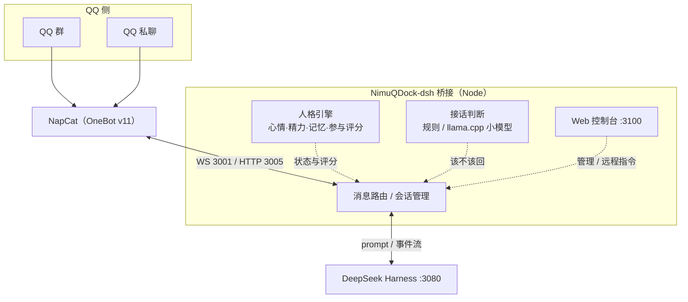

<div align="center">


**美感即匠心 · Beauty is the craft**

# 🔌 NimuQDock-dsh

**把 DeepSeek Harness 的 AI 停靠进 QQ 的对接坞 · 带人格引擎的仿真群友**

[](https://github.com/NimuStudio/NimuQDock-dsh)
[](https://github.com/NimuStudio/NimuQDock-dsh/blob/main/LICENSE)
[](https://nodejs.org)
[](https://github.com/deepseek-ai/deepseek-harness)
[](https://github.com/NapNeko/NapCatQQ)

</div>

---

## 目录

- [1. 这是什么](#1-这是什么)
- [2. 功能](#2-功能)
- [3. 架构](#3-架构)
- [4. 安装](#4-安装)
- [5. 配置](#5-配置)
- [6. 使用](#6-使用)
- [7. 安全与隐私](#7-安全与隐私)
- [8. 已知限制](#8-已知限制)
- [9. 开发与测试](#9-开发与测试)
- [10. 给代码审查者的指南](#10-给代码审查者的指南)
- [11. 目录结构](#11-目录结构)

---

## 1. 这是什么

NimuQDock-dsh 把 **DeepSeek Harness（DSH）** 的 agent 接进 QQ：群/私聊消息经 **NapCat**（OneBot v11）进入桥接进程，桥接把消息送进 DSH 会话，再把 agent 的回复发回 QQ。

和"有问必答的机器人"不同，它有一个**人格引擎**：心情、精力、与群友的关系随互动演化，会判断"这条消息该不该接"，会潜水、会主动冒泡，更接近一个**仿真群友**。

它不是：
- ❌ 不是 QQ 机器人框架（协议接入由 NapCat 负责）
- ❌ 不是多租户 SaaS（所有数据都在本机，单实例运行）
- ❌ 不是 DSH 的替代品（必须有一个可用的 DSH 实例）

## 2. 功能

### 2.1 双模式

| 模式 | 行为 |
|---|---|
| **chat** | 消息自动转发给 DSH，回复原样发回；适合"问答机器人" |
| **agent** | DSH 以 agent 身份运行，自带工具与人格，自主决定看不看、回不回、接不接话题 |

模式通过控制台切换（`POST /api/mode`），立即生效，不重启。

### 2.2 人格引擎（agent 模式）

- **状态**：心情（mood）、精力（energy）、在场状态（active / quiet / away），被怼会掉心情、聊得久会累
- **关系**：对每个群友的熟悉度随互动累积
- **记忆**：群话题滚动统计 + 长期记忆（对群友的印象、没聊完的话题），按相关性注入
- **参与意愿**：`注意力 × 权重 + 兴趣 + 精力 + 心情 + 随机扰动` 超过阈值才说话；被 @ / 引用 / 点名时必回
- **冷却与连发限制**：冷却时间、连续接话上限，避免"刷屏"
- **心跳**：长时间没人说话时按概率主动开话题
- **闭嘴检测**：用户说"别说了/闭嘴/关掉"会静默一段时间

### 2.3 接话判断（规则 / 本地小模型）

| 方式 | 条件 | 说明 |
|---|---|---|
| **规则** | 未安装模型 | @/引用/第二人称/问句/冷却/连续接话等信号打分 |
| **本地模型** | 检测到 llama-server + GGUF | Qwen3-1.7B（推荐）判断语义"是否在叫它"，规则兜底 |

- 模型默认 1.7B；`install-model.bat` 或安装器可换 0.6B（轻量、CPU 可跑）
- 模型缺失/超时/输出异常时**自动回退规则**，聊天不受影响
- 所有下载资源版本固定 + SHA256 校验 + 断点续传

### 2.4 安全边界

- **白名单**：私聊/群各自 allow/deny；**allow 为空时默认拒绝**（fail-closed，`allowAllWhenEmpty=true` 才放行）
- **发送白名单**：回复前二次校验，防止 agent 往未授权会话发消息
- **敏感信息拦截**：命中密钥/手机号/凭据等规则时整条拦截，不外发
- **无本地工具**：QQ 会话的 agent preset 物理上不挂载本地文件/shell 工具；需要执行命令走**控制台远程指令面板**
- **联网搜索**：SSRF 防护（内网地址/非 http(s) 协议拒绝）
- **本地服务**：NapCat、DSH、控制台、判断模型全部只监听 `127.0.0.1`

### 2.5 Web 控制台（`:3100`）

玻璃拟态 UI（薄荷 / 薰衣草 / 粉，深浅两套主题，鼠标跟随泛光）：

- **概览**：运行状态、模式切换、日志
- **会话与记忆**：会话列表、对话记录、长期记忆查看/清理
- **人格**：心情/精力/关系可视化调节、人格卡（角色）管理
- **远程指令**：完整 DSH 工具会话（跑命令、读写文件），结果回显
- **配置**：白名单、模型、群开关、社交参数

鉴权：`console.token`（未配置时启动自动生成并持久化），支持 `Authorization: Bearer` 或 `?token=`。

### 2.6 安装器（Windows）

exe 是**原生 NSIS 安装向导**（不是网页安装器）：

1. 欢迎页 → **组件勾选**（程序本体 / DSH / NapCat / 判断模型 1.7B 或 0.6B / 推理引擎）
2. 启动时自动检测本机：已有项目扫描 + 端口探测（3001/3100/8080）+ 配置文件里的 llama 路径
3. 已装好的组件置灰跳过，没装的默认勾选
4. 安装进度 + 实时日志，完成页可直接启动

下载组件时：版本固定、SHA256 校验、断点续传、60 秒无响应自动换源。

### 2.7 远程指令

控制台里登录后可让 DSH 执行完整工具任务（pwsh / 文件 / 搜索），结果在面板回显——**不经过 QQ 传输层**，适合运维和调参。

## 3. 架构



### 一条消息的旅程

**chat 模式**

```
QQ 消息 → NapCat → 桥接（白名单校验）→ DSH 会话 → 回复 → 白名单二次校验 → QQ
```

**agent 模式**

```
QQ 消息 → NapCat → 桥接
  → 人格引擎：更新状态/记忆，计算参与意愿
  → 接话判断：规则 + 可选本地模型
  → 决定"不接"：静默；决定"接"：送入 DSH agent 会话
  → agent 用 MCP 工具读取上下文、决定回复/潜水
  → 回复经发送白名单校验后发出
```

### 模块地图

| 路径 | 职责 |
|---|---|
| `src/main.js` | 入口：加载配置、启动 NapCat/DSH 客户端、控制台、判断模型 |
| `src/core/router.js` | 消息路由：白名单、模式分派、接话判断（混合决策）、冷却/连发限制 |
| `src/core/session-manager.js` | 会话创建/复用/映射（QQ 会话 ↔ DSH sessionId） |
| `src/core/pump.js` | DSH 事件流 → 回复收集 → 发送 |
| `src/core/sender.js` | 发送前最终校验（白名单/长度/敏感信息） |
| `src/persona/engagement.js` | 参与意愿评分、@/引用/点名识别、闭嘴检测、冷却 |
| `src/persona/state.js` | 心情/精力/关系/在场状态持久化 |
| `src/persona/memory.js` | 分层记忆：话题统计、长期记忆、相关性注入 |
| `src/persona/reply-judge.js` | 本地小模型判断（OpenAI 兼容接口，健康探测、超时回退） |
| `src/persona/judge-dataset.js` | 判断决策日志（脱敏，用于将来训练） |
| `src/policy/allowlist.js` | 白名单判定（fail-closed） |
| `src/console/server.js` | 控制台 HTTP API + 静态页面 + 远程指令 |
| `src/mcp/qq-mcp.js` | 给 agent 的 QQ 工具（读取/发送/记忆） |
| `src/mcp/web-search-mcp.js` | 联网搜索工具（SSRF 防护） |
| `src/installer/steps.js` | 安装步骤：检测、下载（校验/续传）、解压、DSH 安装 |
| `src/installer/assets.js` | 安装资源版本锁定 + SHA256 |
| `installer/installer.nsi` | Windows 原生安装向导 |
| `public/console.html` | 控制台单页 UI |
| `scripts/` | 安装器构建、模型拉取、测试、数据集导出 |

## 4. 安装

### 4.1 exe 安装向导（Windows 10/11）

从 [Releases](https://github.com/NimuStudio/NimuQDock-dsh/releases/latest) 下载：

| 方式 | 大小 | 说明 |
|---|---|---|
| **exe 安装向导** | ~26 MB | 组件按需下载，自动检测本机已装内容 |
| **国内加速直链** | — | `https://gh-proxy.com/https://github.com/NimuStudio/NimuQDock-dsh/releases/latest/download/NimuQDock-dsh-latest-setup.exe` |
| **zip 离线包** | ~410 MB | 内置 0.6B 模型与推理引擎，解压即用 |

### 4.2 源码运行

```bash
git clone https://github.com/NimuStudio/NimuQDock-dsh.git
cd NimuQDock-dsh
npm install
cp config.example.json config.json   # 按需修改
node start.mjs                        # 或 npm start
```

要求：Node.js ≥ 22.13、已安装 QQ 客户端、一个可用的 DSH 实例（默认 `http://127.0.0.1:3080`）。

### 4.3 首次启动

1. 启动 DSH（若尚未运行）
2. 运行 `start.bat` / `node start.mjs`：
   - 检查配置，必要时提示填管理员 QQ / 机器人 QQ
   - 拉起 NapCat（需要 QQ 已安装并登录）
   - 拉起判断模型（若已下载）
   - 启动桥接与控制台
3. 浏览器打开 `http://127.0.0.1:3100`（token 在启动日志里）

## 5. 配置

`config.json`（从 `config.example.json` 复制）：

| 字段 | 默认 | 说明 |
|---|---|---|
| `dsh.baseUrl` | `http://127.0.0.1:3080` | DSH 地址 |
| `dsh.provider` / `dsh.model` | `deepseek-official` / … | 使用的模型 |
| `dsh.reasoningEffort` | `low` | 思考强度 |
| `napcat.wsUrl` / `httpUrl` | `ws://127.0.0.1:3001` / `http://127.0.0.1:3005` | NapCat 接入 |
| `napcat.accessToken` | 空 | OneBot 鉴权（如启用） |
| `napcat.qqPath` | 空 | QQ 安装路径（自动注入失败时指定） |
| `ownerQQ` | 空 | 管理员 QQ（私聊指令/白名单） |
| `agentPreset` / `agentPresetAgent` | `qq-chat` / `qq-agent` | chat / agent 模式使用的 DSH preset |
| `allow` / `deny` | 空 | 白名单（私聊号 / 群号） |
| `allowAllWhenEmpty` | `false` | 白名单为空时是否放行（默认拒绝） |
| `maxReplyChars` | `1000` | 单条回复长度上限 |
| `console.port` / `console.token` | `3100` / 空 | 控制台端口与 token（空则自动生成） |
| `security.interceptNotify` | `true` | 敏感信息拦截 |
| `vision.enabled` | `true` | 识图（需 DSH 支持 vision 模型） |
| `social.*` | 见示例 | 人格引擎参数：权重、阈值、冷却、心跳、记忆、话题 |
| `judge.enabled` / `judge.url` / `judge.modelPath` | `auto` / `:8080` / 空 | 接话判断模型 |
| `dshCheckIntervalMs` | `5000` | DSH 健康检查间隔 |

> 敏感文件：`config.json`、`state/`、`models/`、`llama/`、`NapCatShell/` 均在 `.gitignore`，不会提交。

## 6. 使用

### 控制台

- **切换模式**：概览页 → chat / agent
- **人格调节**：人格页可视化拖动心情/精力，或直接编辑人格卡
- **白名单**：配置页添加允许的群/私聊；空列表默认拒绝
- **远程指令**：输入命令 → DSH 执行 → 结果回显（不经过 QQ）
- **记忆管理**：查看长期记忆、清理过期条目

### 常用命令

```bash
npm start              # 启动（= node start.mjs）
npm run self-test      # 基础自检
npm run test-persona   # 人格引擎测试
npm run test-onebot    # OneBot 协议测试
npm run fetch-judge    # 下载判断模型（默认 1.7B，--small 为 0.6B）
npm run export-judge   # 导出判断数据集（训练用）
```

## 7. 安全与隐私

### 信任边界

| 边界 | 措施 |
|---|---|
| QQ → 桥接 | 白名单（fail-closed）、长度限制、敏感信息拦截 |
| 桥接 → QQ | 发送前二次白名单校验；未授权会话直接丢弃 |
| agent → 本机 | QQ 会话的 preset 不挂载本地工具；需要时走控制台 |
| 外部请求 | 搜索工具 SSRF 防护；本地服务只监听 127.0.0.1 |
| 安装器 | 本地 token + Host 校验（防 CSRF/DNS rebinding）；资源版本固定 + SHA256 |

### 数据存在哪

- 配置、状态、记忆、日志：项目目录 `state/` 与 `config.json`
- DSH 会话/凭据：`~/.dsh`
- NapCat 登录数据：`NapCatShell/`
- **不上传任何数据**；模型/组件下载直接走上游源

### 已知风险

- 安装器下载源是第三方（ModelScope / GitHub / npmmirror），已用 SHA256 兜底，但无法防御上游主动投毒
- 控制台 token 为空时自动生成并落盘，本机其他进程可读取
- agent 工具在"远程指令"面板里是**完整权限**，请勿把控制台暴露到公网

## 8. 已知限制

- **DSH 0.2 的审批/提问**：桥接目前只提示不支持，需到 DSH 网页处理
- **判断模型**：默认零样本，未做 LoRA（训练脚本已提供，数据在 `state/judge-decisions.jsonl`）
- **Windows 优先**：打包/安装器只面向 Windows；源码可在其他平台跑但未验证
- **单实例**：同一数据目录只允许一个桥接进程（`state/bridge.lock`）
- **测试**：目前是 `scripts/test-*.mjs` 手动测试，CI 只做构建与发布，没有自动化测试套件
- **网页安装器已废弃**：exe 已改为 NSIS；`install-ui.mjs` 仅保留给 zip 用户

## 9. 开发与测试

```bash
npm install
npm run self-test        # 自检
npm run test-persona     # 人格/参与意愿
npm run test-directed    # @/点名识别
npm run test-onebot      # OneBot 消息构造
npm run test-loop        # 端到端回路
```

- **构建/发布**：打 tag（`v*`）触发 `.github/workflows/release.yml`：拉取便携 Node/模型 → 构建 zip + NSIS 安装器 → 产物来源证明 → GitHub Release
- **模型/推理**：`scripts/fetch-judge-model.mjs`（版本固定 + SHA256 + 断点续传）
- **安装器**：`node scripts/make-installer-nsis.mjs <版本>`（需要 `makensis`）

## 10. 给代码审查者的指南

重点看这些文件与场景：

| 风险点 | 位置 | 建议检查 |
|---|---|---|
| 白名单绕过 | `src/policy/allowlist.js`、`src/core/router.js`、`src/core/sender.js` | allow/deny 边界、fail-closed、发送前二次校验 |
| 工具权限 | `dsh/agent-presets/*/preset.yml`、`src/mcp/*.js` | QQ 会话是否真的没有本地工具；MCP 工具参数校验 |
| 提示注入 | `src/persona/inject.js`、`src/core/pump.js` | 群消息是否直接拼进系统提示、是否有边界标记 |
| SSRF | `src/mcp/web-search-mcp.js` | 内网地址/协议/重定向是否拦截 |
| 凭据与日志 | `src/state.js`、`src/log.js`、`src/console/server.js` | token 落盘、日志是否泄露消息内容 |
| 供应链 | `src/installer/assets.js`、`src/installer/steps.js`、`installer/installer.nsi` | 版本固定、SHA256、镜像回退、卸载残留 |
| 并发/状态 | `src/core/session-manager.js`、`src/persona/state.js` | 多消息并发、会话复用、状态持久化竞争 |

审查时可运行：

```bash
npm run self-test
npm run test-persona
```

## 11. 目录结构

```
napcat-bridge/
├── src/
│   ├── main.js                 # 入口
│   ├── core/                   # 路由 / 会话 / 发送 / 事件泵
│   ├── persona/                # 人格引擎（状态/记忆/参与/判断/注入）
│   ├── policy/                 # 白名单
│   ├── console/                # 控制台 HTTP 服务
│   ├── mcp/                    # 给 agent 的 QQ / 搜索工具
│   ├── installer/              # 安装步骤与资源锁定
│   └── lib/                    # 工具函数
├── public/                     # 控制台 UI（单页）
├── dsh/agent-presets/          # qq-chat / qq-agent 两个 preset
├── plugins/qq-mode-console/    # DSH 侧插件（模式设置同步）
├── installer/installer.nsi     # NSIS 安装向导
├── scripts/                    # 构建/模型/测试脚本
├── docs/screenshots/           # 截图
└── config.example.json
```

---

## 下载 / 链接

- Releases：<https://github.com/NimuStudio/NimuQDock-dsh/releases/latest>
- 国内加速：<https://gh-proxy.com/https://github.com/NimuStudio/NimuQDock-dsh/releases/latest/download/NimuQDock-dsh-latest-setup.exe>
- DeepSeek Harness：<https://github.com/deepseek-ai/deepseek-harness>
- NapCat：<https://github.com/NapNeko/NapCatQQ>

## License

见 [LICENSE](LICENSE)。
