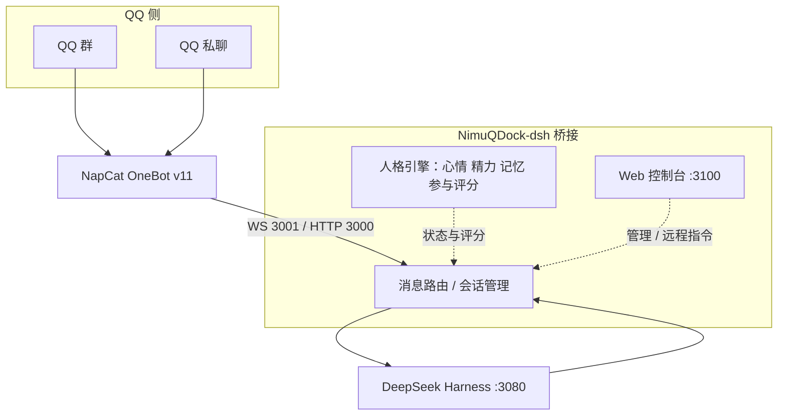
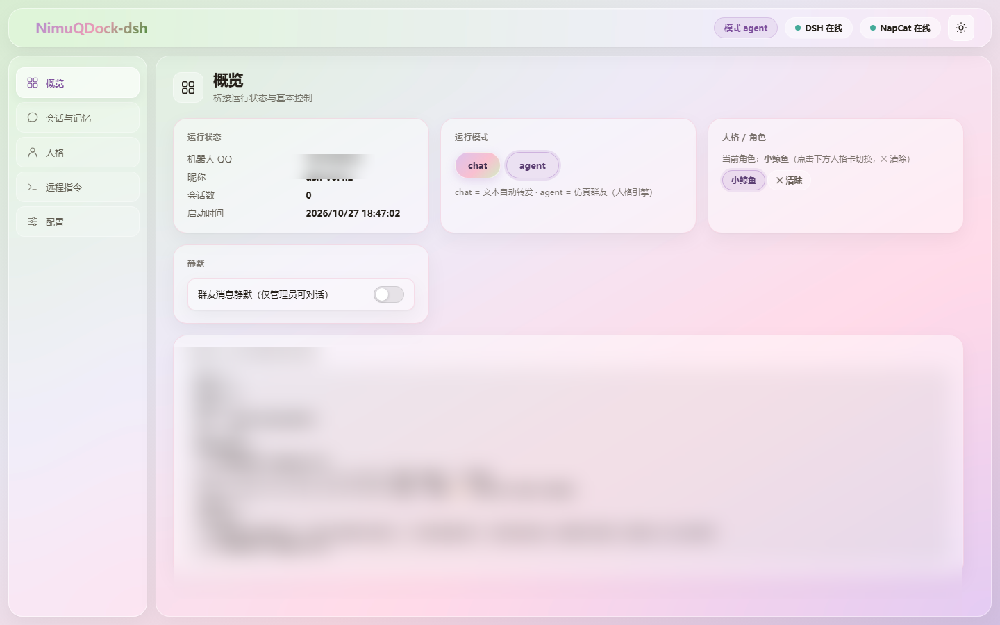
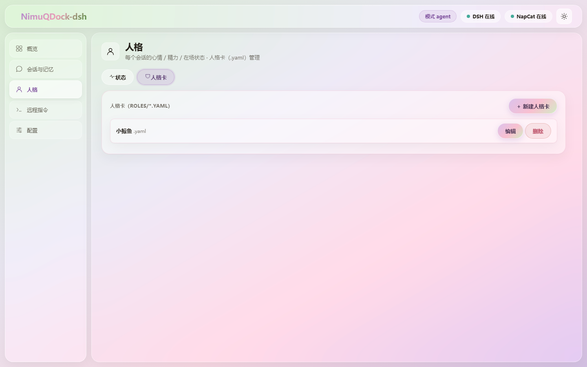
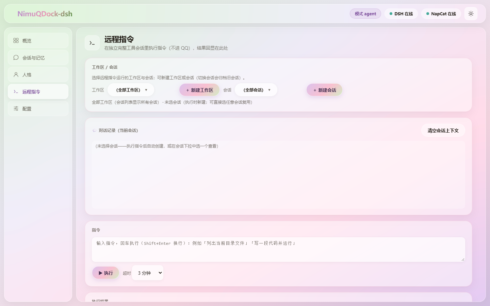

<div align="center">


**美感即匠心 · Beauty is the craft**

# 🔌 NimuQDock-dsh

**把 DeepSeek Harness 的 AI 停靠进 QQ 的对接坞 · 带人格引擎的仿真群友：心情、精力、记忆，像真人一样潜水与参与**

[](https://github.com/NimuStudio/NimuQDock-dsh)
[](https://github.com/NimuStudio/NimuQDock-dsh/blob/main/LICENSE)
[](https://nodejs.org)
[](https://github.com/deepseek-ai/deepseek-harness)
[](https://github.com/NapNeko/NapCatQQ)

[**中文**](README.md) · [**English**](README.en.md) · [贡献指南](CONTRIBUTING.md) · [安全问题](SECURITY.md) · [更新日志](CHANGELOG.md)

</div>

> 由 [Nimu Studio](https://nimustudio.cn) 维护 · 官网 [nimustudio.cn](https://nimustudio.cn)

---

## 目录

- [下载](#下载)
- [这是什么](#这是什么)
- [架构](#架构)
- [截图](#截图)
- [特性](#特性)
- [系统要求](#系统要求)
- [兼容性](#兼容性)
- [一键安装（Windows）](#一键安装windows)
- [卸载](#卸载)
- [开始使用](#开始使用)
- [常见问题](#常见问题)
- [已知限制](#已知限制)
- [能力一览](#能力一览)
- [项目结构](#项目结构)
- [讨论](#讨论)
- [配套组件](#配套组件)
- [支持者](#支持者)
- [支持](#支持)
- [参与贡献与安全问题报告](#参与贡献与安全问题报告)
- [数据与隐私](#数据与隐私)
- [使用提醒](#使用提醒)
- [许可证与第三方](#许可证与第三方)
- [联系](#联系)

## 下载

| 方式 | 链接 | 说明 |
|---|---|---|
| **exe（图形安装器，约 26–30 MB）** | [GitHub Releases](https://github.com/NimuStudio/NimuQDock-dsh/releases/latest) | 自动检测本机组件，勾选要装的 DSH / NapCat / 判断模型 |
| **国内加速**（推荐） | [gh-proxy 直链](https://gh-proxy.com/https://github.com/NimuStudio/NimuQDock-dsh/releases/latest/download/NimuQDock-dsh-latest-setup.exe) | 固定文件名，始终指向最新版 |
| **zip 完整离线包** | Releases 页面的 Assets | 完整离线包（含推理引擎与判断模型，具体以该版本 Releases 资产与说明为准），解压即用，适合网络不好 |

> 安装器下载 NapCat、推理引擎、判断模型时会自动走国内镜像；只有 exe 本身需要走上面的加速链接。
> 安装内容都在安装目录内，卸载删目录即可。

## 这是什么

NimuQDock-dsh 把 DeepSeek Harness 的 agent 请进 QQ 群和私聊：群里有人说话，它就能听见；它想开口时，回复会出现在群里。在此基础上，**人格引擎**让它不是有问必答的客服，而是一个有心情、有精力、有记忆、会潜水也会冒泡的**仿真群友**。

一条消息的旅程：

```
① 群友在 QQ 发言（NapCat 以 OneBot v11 协议上报）
        │
        ▼
② 桥接进程把消息投入对应的 DSH 会话
        │
        ▼
③ agent 思考完毕：产出回复 / 提问 / 工具审批
        │
        ▼
④ 结果发回 QQ（chat 模式自动回；agent 模式由 AI 用工具自主收发）
```

> chat 模式：①②③④ 全自动；agent 模式：AI 自己看消息、自己决定回不回、自己挑话题接。

## 架构



- **QQ 侧**：NapCat 负责接入 QQ 协议，把群/私聊消息以 OneBot v11 协议上报
- **桥接进程**：收到消息后路由到对应 DSH 会话；agent 的回复（含提问、工具审批）原路发回 QQ
- **人格引擎**（agent 模式）：用心情/精力/记忆计算参与意愿，决定"这条要不要接"
- **Web 控制台**：本地管理界面，可切换模式、调人格、管白名单、发远程指令

## 截图

| 概览 | 人格卡 |
|---|---|
|  |  |

| 远程指令 |
|---|
|  |

> 截图中的机器人 QQ 号与群聊内容已打码。

## 特性

- 🧠 **人格引擎**：心情 / 精力 / 与群友的关系随互动演化，被怼心情下降、聊得多关系变熟、精力低了倾向潜水
- 🎯 **参与意愿模型**：不是"每条都回"，而是按「被点名程度 + 话题兴趣 + 精力 + 心情 + 随机扰动」评分，超过阈值才参与——被 @/提问必回，普通闲聊按状态决定
- 💾 **分层记忆**：群话题滚动统计 + 长期记忆（对群友的印象、没聊完的话题），按相关性自动注入
- 🛡️ **安全边界**：QQ 会话物理上没有本地工具、发送强制白名单、回复敏感信息整条拦截、联网搜索带 SSRF 防护
- 🎛️ **Web 控制台**（玻璃拟态 UI）：人格状态可视化调节、白名单管理、角色卡管理、远程指令面板（完整工具会话）、记忆/日志/会话管理
- 🚀 **远程指令面板**：登录控制台即可让 DSH 的完整工具（pwsh/文件等）执行任务，结果回显——不经 QQ 传输层

## 系统要求

| 项目 | 要求 | 说明 |
|---|---|---|
| 操作系统 | Windows 10 / 11（x64） | 安装器（NSIS）与 `start.bat` 只面向 Windows；macOS / Linux 可自行按源码运行，未做验证 |
| Node.js | **≥ 22.13** | `package.json` 的 `engines` 硬性要求，版本过低启动时会直接报错退出；exe / zip 发行包自带 Node，源码运行需自备 |
| QQ 客户端 | 已安装 QQNT 客户端 | NapCat Shell 版靠注入 QQ 进程工作，必须先装官方客户端 |
| DeepSeek Harness | 0.2.1-rc.5（项目锁定版本） | 需要先启动 DSH 且本机可访问，地址填在 `config.json` 的 `dsh.baseUrl` |
| 内存 | 无硬性下限（本项目未做内存基准测试） | 纯文字聊天场景只要能同时跑 DSH + 桥接 + NapCat 即可；启用 1.7B 判断模型时要额外为它留内存 |
| 磁盘 | 无硬性下限，随勾选组件增长 | 判断模型 0.6B 约 379 MB / 1.7B 约 1.1 GB，CPU 版推理引擎约 23 MB，完整离线包约 410 MB；全部装在安装目录内 |
| GPU | **非必需** | 默认用发行包自带的 CPU 版 `llama-server` 跑接话判断（实测约 100~200 ms/条）；有 NVIDIA 显卡可在 `judge.llamaServer` 指向自己的 CUDA 版，判断更快 |

## 兼容性

DSH 侧**不读版本号字符串**，而是启动时探测接口形态，按 DSH 0.1.x 与 0.2.x 两代协议自适应；启动日志会打印 `DSH 协议：0.2.x` 或 `0.1.x`。

| 组件 | 支持范围 | 说明 |
|---|---|---|
| DeepSeek Harness 0.1.x | 支持（自适应） | 走 `/api/<ns>.<method>` + `/api/events.mux`；0.1.1 没有持久化 secret 时自动退化为免鉴权 |
| DeepSeek Harness 0.2.x | 支持（自适应） | 走 `/api/<ns>/<method>` + `/api/remote.mux` |
| **实测 DSH 版本** | **0.2.1-rc.5** | 项目锁定值（安装器也按这个版本装 DSH）；其它版本可能可用，但 0.2.1-rc.5 之外的组合未做验证 |
| NapCat | OneBot v11（正向 WebSocket + HTTP 动作） | 未锁定 NapCat 版本；Windows 用 Shell 版（需 QQNT），Linux 用 Docker 版 |
| QQ 客户端 | QQNT | 跟随官方更新，项目不做钉版 |
| 本地判断模型（可选） | llama.cpp + Qwen3 0.6B / 1.7B GGUF | Apache-2.0；缺省随包提供 CPU 版推理引擎 |

默认端口（全部只监听 `127.0.0.1`）：

| 端口 | 用途 | 配置项 / 依据 |
|---|---|---|
| 3080 | DSH Web（默认） | `config.example.json` 的 `dsh.baseUrl`；DSH 起在别的端口（例如本机实测另用 3090 独立实例）就改这里 |
| 3100 | 桥接 Web 控制台 | `config.example.json` 的 `console.port` |
| 3001 | NapCat WebSocket 服务端 | `config.example.json` 的 `napcat.wsUrl` |
| 3000 | NapCat HTTP 服务端（默认） | `config.example.json` 的 `napcat.httpUrl` |
| 3005 | NapCat HTTP 服务端（3000 被占用时的回退） | `start.mjs` 的 `pickPort`；自动安装会写回 `config.json` |
| 8080 | 本地判断模型 `llama-server`（可选） | `config.example.json` 的 `judge.url` |
| 6099 | NapCat WebUI | NapCat 自带，与桥接无关 |

> 上表默认值取自 `config.example.json`；实际以你的 `config.json` 与启动日志为准。端口被占用时，自动安装脚本会挑一个空闲端口并写回配置。

## 一键安装（Windows）

去 [Releases](https://github.com/NimuStudio/NimuQDock-dsh/releases/latest) 下载安装包（含全部依赖，无需 npm install）：

| 方式 | 大小 | 操作 |
|---|---|---|
| **exe 安装向导（推荐）** | 约 26–30 MB | 双击 → 勾选组件（程序本体 / DSH / NapCat / 判断模型）→ 选目录 → 安装 → 完成页直接启动 |
| **zip 离线包** | 约 410 MB | 解压 → 双击 `start.bat`（完整离线包，含推理引擎与判断模型；具体以该版本 Releases 资产与说明为准） |

安装向导会自动检测本机已装的组件（已装好的置灰跳过），下载时会走国内镜像、支持断点续传与 SHA256 校验。
你只需要两件手动事：**① 安装 QQ 客户端 ② 扫码登录并配置 OneBot11**，最后启动并打开 Web 控制台。

> 发行包自带 Node.js；源码运行需要 Node.js ≥ 22.13 与已安装的 QQ 客户端。

## 卸载

- **exe 安装的用户**：Windows「设置 → 应用」里卸载，或运行安装目录下的 `uninstall.exe`。
- **zip / 源码用户**：双击项目里的 `uninstall.bat`。
- 卸载会先停止运行中的桥接与 NapCat 注入进程，再删除安装目录。
- 卸载前会自动把 `state/`（记忆、日志）和 `config.json` 备份到「文档\NimuQDock-dsh-backup」，需要时可以手动恢复。

## 开始使用

### 需要准备

| 依赖 | 说明 |
|---|---|
| Node.js | ≥ 22.13 |
| DeepSeek Harness | 见下方「先装好 DeepSeek Harness」 |
| NapCat | QQ 协议实现，[下载](https://github.com/NapNeko/NapCatQQ/releases/latest) |
| QQ 账号 | 一个用于机器人的 QQ 号（建议小号） |

### 先装好 DeepSeek Harness（DSH）

本项目把 AI 放在 [DeepSeek Harness](https://github.com/deepseek-ai/deepseek-harness) 里运行，需要先把它启动起来：

```bash
# 方式一：临时运行（想先试试就用这个）
npx @deepseek-ai/dsh web

# 方式二：全局安装后运行
npm i -g @deepseek-ai/dsh
dsh web
```

浏览器打开 `http://127.0.0.1:3080` 能看到 DSH 界面即成功。DSH 的地址/端口在 `config.json` 的 `dsh.baseUrl` 配置（默认 `http://127.0.0.1:3080`），改了地址就同步改这里。

### ① 安装依赖

```bash
npm install
```

### ② 让 NapCat 上线

> **版本选择**：**Windows** 用 **Shell 版**（需先安装 QQ 客户端 QQNT，扫码登录）；**Linux 服务器**用 **Docker 版**（镜像自带 Linux QQ）。以下步骤以 Windows Shell 版为例。

1. 下载 NapCat 并按官方教程把它接入你的 QQ 账号（扫码登录，会要求已安装 QQ 客户端）。
2. 打开 NapCat WebUI：`http://127.0.0.1:6099/webui`（默认口令 `napcat`）。
3. 进入 **网络配置**，新建两个连接，**消息格式都选 `array`**：
   - **HTTP 服务端**：`127.0.0.1:3000`（端口可自定义；若 3000 被别的程序占用，换一个空闲端口——例如 3005——并同步改 `config.json` 的 `napcat.httpUrl`；用 `start.bat` 自动安装时这一步由脚本完成）
   - **WebSocket 服务端**：`127.0.0.1:3001`
4. 如果在 WebUI 里设置了 accessToken，记下来，下一步填进 `config.json`；两边都留空也可以，但必须一致。

> 用 `start.bat` 自动安装时不用手动做这一步：桥接会生成 `onebot11_<机器人QQ号>.json` 并自动避开被占用的端口，实际端口以 `config.json` 的 `napcat.wsUrl`/`httpUrl` 为准。

生成的 OneBot11 配置在 NapCat 目录的 `config/onebot11_<机器人QQ号>.json`。

> **用自己的 QQ 时注意**：NapCat 需要把 QQ 重新拉起才能注入，所以启动机器人会把你当前登录的 QQ 退出。
> 想两边同时用，给机器人单独准备一份 QQ（把现有 QQ 安装目录整个复制一份即可），然后在 `config.json` 里设置
> `"napcat": { "qqPath": "D:\\QQ-bot\\QQ.exe" }` —— `start.bat` 会优先用这个路径，你自己的 QQ 不受影响。
>
> 注意：同一个机器人 QQ **不能**在两台机器上同时登录，会触发风控互踢（见「已知限制」）。

### 接话判断：规则 / 本地模型（可选）

agent 模式下「这条消息该不该接」有两种判断方式，桥接会自动选择：

| 方式 | 条件 | 说明 |
|---|---|---|
| **规则**（默认） | 未安装模型 | 基于 @/引用/第二人称/问句/冷却/连续接话等信号打分 |
| **本地模型** | 检测到 llama-server + GGUF | 小模型判断语义（是否在叫它），上下文信号仍由规则兜底 |

- 模型：[Qwen3-1.7B Q4_K_M](https://www.modelscope.cn/models/unsloth/Qwen3-1.7B-GGUF)（约 1.1 GB，Apache-2.0；实测 20/20，判断约 200ms/条）
  - 轻量替代：`npm run fetch-judge -- --small` 换成 0.6B（约 379 MB，CPU 也能跑）
- 推理：[llama.cpp](https://github.com/ggml-org/llama.cpp) 的 `llama-server`（发行包自带 CPU 版，约 23 MB）
- 安装：`npm run fetch-judge`（默认 1.7B；加 `-- --small` 换 0.6B；模型放 `models/`，推理放 `llama/`）
  - 发行包按发布流程内置 0.6B（以该版本 Releases 资产为准）；想要更准，双击 `install-model.bat` 升级到 1.7B（约 1.1 GB）
- 自动回退：模型没装、启动超时、或输出异常时，**自动退回规则**，聊天不受影响
- chat 模式：不经过判断，所有消息原样交给 DSH

`config.json` 相关配置：

```json
"judge": {
  "enabled": "auto",          // auto | on | off
  "url": "http://127.0.0.1:8080",
  "modelPath": "",            // 留空自动用 models/ 下的第一个 .gguf
  "llamaServer": "",          // 留空自动用 llama/llama-server.exe；有 N 卡可指向自己的 CUDA 版
  "timeoutMs": 2500
}
```


#### 训练自己的判断器（可选，进阶）

桥接会把每次判断写进 `state/judge-decisions.jsonl`（只记消息文本，已脱敏）。积累一段时间后：

```bash
npm run export-judge     # 导出 dataset/judge-train.jsonl（正负均衡、去重）
npm run train-judge      # LoRA 微调 Qwen3-0.6B（需要 Python + torch/peft/datasets）
```

训练产物需要合并 adapter 并转成 GGUF 才能给 llama.cpp 用（脚本头部有完整步骤）。
没有 GPU 也能用：llama.cpp 的 CPU 版随包提供，只是判断稍慢（约 100~200ms/条）。

### ③ 填写 config.json

```bash
copy config.example.json config.json
```

主要字段：

| 字段 | 说明 |
|---|---|
| `dsh.baseUrl` | DSH Web 服务地址，默认 `http://127.0.0.1:3080` |
| `dsh.provider` / `dsh.model` / `dsh.reasoningEffort` | 模型供应商 / 模型名 / 推理强度（`off`/`low`/`high`/`max`）；若你的 DSH 没有示例中的模型，改成 DSH 设置页里可用的即可。**回复慢就调低推理强度**（`low` 比 `max` 快 30%~45%，闲聊足够） |
| `napcat.wsUrl` | NapCat WebSocket 服务端地址，默认 `ws://127.0.0.1:3001` |
| `napcat.httpUrl` | NapCat HTTP 服务端地址，默认 `http://127.0.0.1:3000`；自动安装时若 3000 被占用会改用空闲端口并写回这里（**别填成 WS 端口**） |
| `napcat.qqPath` | 机器人专用的 QQ 路径（留空自动检测）。NapCat 注入会重启 QQ，填一份独立的 QQ 可避免退出你自己的 QQ |
| `napcat.accessToken` | 与 WebUI 里设置的 accessToken 一致，未配置留空 |
| `ownerQQ` | 管理员 QQ 号（agent 模式的私聊唤醒、管理操作等） |
| `agentPreset` | chat 模式使用的 DSH agent preset，默认 `qq-chat` |
| `agentPresetAgent` | agent 模式使用的 DSH agent preset，默认 `qq-agent` |
| `workspaceTitle` | QQ 会话在 DSH 界面里的归组名称，默认「QQ 聊天」 |
| `allow.private` / `allow.groups` | 私聊 / 群聊白名单（QQ 号 / 群号数组），**建议先填上** |
| `deny.private` / `deny.groups` | 黑名单，优先级高于白名单 |
| `allowAllWhenEmpty` | 白名单为空时是否放行全部，默认 `false`（保持默认） |
| `ackMessage` | 收到消息后的即时回复文本，空字符串关闭 |
| `sendDelayMs` | QQ 连续发送间隔，防止触发频率限制 |
| `maxReplyChars` | agent 单条回复最大字符数，超出自动分段 |
| `console.port` / `console.token` | Web 控制台端口（默认 `3100`）与访问令牌；token 留空则启动时自动生成并打印 |
| `security.interceptNotify` | 回复被敏感拦截时是否提示 |
| `vision.enabled` / `vision.maxImageBytes` | 图片理解开关与大小上限（需 vision 模型） |
| `queue.maxPerSession` | DSH 掉线期间每会话缓存的消息条数上限 |
| `social.*` | 人格引擎参数（默认人格、参与评分权重、心跳、记忆、话题窗口），一般保持默认 |

> 白名单为空且 `allowAllWhenEmpty` 为 `false` 时，桥接**谁都不回**——这是默认的安全姿态。
> `config.json` 里会出现真实的 QQ 号 / 群号 / NapCat accessToken，**不要把它外传、截图或提交到仓库**（该文件不入库）。

### ④ 给 DSH 装 preset 和 MCP

```bash
node scripts/setup-dsh.mjs
```

脚本会把 `qq-chat` / `qq-agent` 两套 agent preset、两个 MCP server（QQ 安全工具 + 联网搜索）和一个设置页插件装进 DSH 环境，并写入本地 `state/mode.json` 兜底。可重复运行；**移动过项目目录后必须重跑**（MCP/插件路径是绝对路径）。装完**重启 DSH** 生效。

### ⑤ 启动

```bash
npm start
# 或双击 start.bat（守护模式：崩溃后 5 秒自动拉起）
```

日志依次出现 `配置已加载` → `DSH 已连接` → `NapCat 已连接` → `桥接已启动` 即成功。

> 提示：桥接只能跑一个实例（单实例锁）。出现「已有实例在运行」时双击 `restart.bat` 一键重启，或手动删除 `state/bridge.lock`。

### 验证与日常使用

- 给机器人**私聊**或**群里 @ 它**，看它是否回复。
- 打开 Web 控制台 `http://127.0.0.1:3100`（令牌在启动日志里）：查看状态、切换 **chat / agent** 模式、调节人格、管理白名单、发远程指令。
- agent 模式 = 仿真群友：AI 主动看消息、按人格决定参不参与；agent 模式私聊只响应 `ownerQQ`。
- 重启 DSH 不需要动桥接：桥接会自动探活，DSH 掉线期间的消息会入队缓存，恢复后自动补投。

### 配置人格卡（角色扮演）

- 控制台「🧠 人格 → 人格卡」页可**新建 / 编辑** `roles/*.yaml`：一个文件 = 一个完整人格，保存即生效（自动清缓存）。
  `prompt` 字段就是人设文本（注入给 AI 的身份、说话风格、雷点）；其余字段（心情/精力/兴趣/参与度）驱动人格引擎。
- **chat 模式**切换角色：控制台「📊 概览 → 人格 / 角色」点人格卡即可（群友无法更改）。
- **agent 模式**默认人格：改 `config.json` 的 `social.defaultPersona`（如 `小鲸鱼`），保存后重启桥接生效。

### 离线自测（不需要 QQ）

```bash
npm run self-test        # 桥接与 DSH 的连接链路
npm run test-loop        # chat 闭环（真实 DSH + 假 QQ）
npm run test-loop -- --mode agent   # agent 闭环（唤醒/潜水）
npm run test-persona     # 人格引擎单测
npm run test-agent-api   # agent 内部 API
npm run test-mcp-web     # SSRF 防护搜索
npm run test-onebot      # NapCat 连接
```

> 需要连 DSH 的脚本支持用 `DSH_URL` 指定地址（未设置时按 `DSH_URL` → `config.json` 的 `dsh.baseUrl` → `127.0.0.1:3080` 派生），例如 `DSH_URL=http://127.0.0.1:3090 npm run self-test`。

## 常见问题

| 现象 | 处理 |
|---|---|
| HTTP 426（Upgrade Required） | `napcat.httpUrl` 填成了 WebSocket 端口；检查 config.json 与 `onebot11_<机器人QQ号>.json` 的端口是否一致 |
| 群里 @ 没反应 | 群号是否在白名单 `allow.groups`；agent 模式下检查它是不是在潜水（参与评分没过阈值） |
| 私聊没反应 | 私聊白名单 `allow.private`；agent 模式只响应 `ownerQQ` |
| 改了 MCP 或 preset 不生效 | MCP 由 DSH 拉起，改 `src/mcp/*.js` 或 `dsh/agent-presets/` 后要**重启 DSH** |
| 提示「已有实例在运行」 | 单实例锁残留，双击 `restart.bat` 或删 `state/bridge.lock` |
| 模型选择失败 | `dsh.model` 改成 DSH 设置页里实际可用的模型 |
| 日志只有「接话判断：规则模式」 | 判断模型（8080）没起或 `judge.modelPath` 不对；不需要模型时这是正常状态 |

## 已知限制

按现状如实记录，**未修复**。某项被处理时会先更新 [CHANGELOG.md](CHANGELOG.md)，再改本节。

1. **DSH 0.2.x 的审批 / 提问回调未实现**：`src/transport/dsh-client-v2.js` 收到 `approval-asked` 事件后直接返回，不向上转发。agent 模式遇到工具审批或提问时会停在 DSH 一侧，需要到 DSH 网页里手动处理。
2. **判断模型未启动时不报错**：8080 上的 `llama-server` 没起来时，桥接不会失败，而是静默降级为规则模式，日志只写一行 `接话判断：规则模式（未检测到本地模型，可选安装）`。
3. **同一个机器人 QQ 不能两台机器同时登录**：会触发风控互踢。迁移或换机前，先停掉旧机器上的桥接与 NapCat。
4. **v2 协议下控制台的 workspace 列表为空**：DSH 0.2 的 `workspace/list` 语义是目录浏览，不是工作区注册表，控制台相应位置因此降级为空列表（不影响会话收发）。
5. **便携自举路径未验证**：`start.bat` 起 3081 便携 DSH 的分支目前没有验证通过记录。

## 能力一览

| 功能 | 说明 |
|---|---|
| chat 模式 | 文本自动转发，安全聊天 |
| agent 模式 | 仿真群友：人格引擎 + 参与意愿 + 工具自主收发 |
| 人格引擎 | 心情/精力/关系/在场状态演化（持久化） |
| 分层记忆 | 群话题 + 长期记忆按相关性注入 |
| 主动心跳 | 人格驱动"偶尔看看群" |
| Web 控制台 | 状态/模式/人格调节/角色卡/记忆/远程指令/白名单/日志 |
| 远程指令 | 完整工具会话执行，结果回显 |
| 接话判断 | 规则 + 可选本地小模型，模型缺失自动回退 |
| 图形安装器 | 原生 Windows 安装向导，按需下载组件 |
| 安全 MCP | 白名单发送 + SSRF 防护搜索 |

## 项目结构

| 目录 | 作用 |
|---|---|
| `src/transport/` | NapCat OneBot11 客户端、DSH WebSocket 下行客户端（0.1.x / 0.2.x 两代） |
| `src/core/` | 会话管理 / 消息路由 / 发送链 / 事件泵 / turn 收集 |
| `src/persona/` | 人格引擎：状态 / 记忆 / 参与度 / 词库 / 令牌 |
| `src/mcp/` | 安全 QQ 工具 MCP + SSRF 防护搜索 MCP |
| `src/console/` | Web 控制台 + `/agent/v1` 内部 API |
| `dsh/` | DSH 端 agent preset（qq-chat / qq-agent） |
| `roles/` | 人格卡（YAML，prompt 内嵌人设） |
| `scripts/` | 安装 / 测试脚本 |
| `docs/` | 架构与实现规格（DESIGN.md / PERSONA_ENGINE.md / DEPLOY.md） |

## 讨论

💬 有问题或想交流？欢迎来 [GitHub Discussions](https://github.com/NimuStudio/NimuQDock-dsh/discussions) 聊聊。

加入 **Nimu Studio 用户交流群**：QQ 群 `1097466590`（或加作者 QQ `2998827169`），一起交流、反馈、催更。

## 配套组件

- 🎨 控制台的玻璃拟态 UI 来自 [**Nimu Glass UI**](https://github.com/NimuStudio/Nimu-glass-ui)（三主题玻璃拟态 UI 体系）
- ⚡ 需要轻量 WebSocket 通讯？[**NimuChat**](https://github.com/NimuStudio/NimuChat)

## 支持者

感谢以下支持者让这个项目持续下去 ❤️

| 支持者 | 赞助档位 | 日期 |
|---|---|---|
| 等你来 ⭐ | 支持者 ¥18 | — |

> 想支持这个项目？☕ [去爱发电请我喝杯咖啡](https://ifdian.net/a/NimuStudio)。**¥18 支持者档**支持者的名字（GitHub 用户名或昵称）会永久列入上表。

## 支持

喜欢这个项目？☕ [去爱发电请我喝杯咖啡](https://ifdian.net/a/NimuStudio)

## 参与贡献与安全问题报告

| 想做的事 | 去哪 |
|---|---|
| 提代码 / 改文档 | 先读 [CONTRIBUTING.md](CONTRIBUTING.md)：开发环境、把项目跑起来、测试命令、代码风格、提交信息约定、PR 要求 |
| 报告安全漏洞 | **不要**开公开 issue，按 [SECURITY.md](SECURITY.md) 的私密渠道报告 |
| 看改了什么 | [CHANGELOG.md](CHANGELOG.md)（面向用户，只记可感知的变化） |

- **双语文档同步维护**：改 [README.md](README.md) 时请同步改 [README.en.md](README.en.md)，两份保持同一结构与同一事实。
- **报告问题时请给可复现信息**：Windows 版本、`node -v`、DSH 版本、`config.json` 里**已打码**的端口配置、以及相关日志行。真实 QQ 号 / 群号 / accessToken 请务必抹掉。
- 文档里写到的测试命令都在 `package.json` 的 `scripts` 里，可直接复制执行。

## 数据与隐私

- 所有数据都在本机：`config.json`、`state/`（记忆/日志）、`NapCatShell/`（QQ 登录）、`~/.dsh`（DSH 会话）
- 不上传任何数据；模型/组件下载直接走上游官方源
- 控制台、DSH、NapCat、判断模型都只监听 `127.0.0.1`
- 控制台 token 落盘在 `state/console-token`；Windows 下文件权限依赖本机进程隔离（POSIX 的 0600 不生效）
- `state/judge-decisions.jsonl` 会保存**脱敏后的群聊文本**，用于以后训练判断模型；不需要可删除该文件

## 使用提醒

把 agent 接进 QQ，等于把账号的发言权交给了模型。对外使用前请务必先配置好白名单（`allow.private` / `allow.groups`），谨慎评估风险。

NapCat 与 QQ 客户端的第三方属性、以及自动化操作 QQ 账号的风控风险，见下一节「许可证与第三方」。

## 许可证与第三方

本项目以 [MIT](LICENSE) 许可证发布，全文见 [LICENSE](LICENSE)。

第三方组件与归属：

| 组件 | 属性 | 说明 |
|---|---|---|
| NapCat | 第三方开源项目（独立维护） | 提供 QQ 协议层（OneBot v11），与腾讯公司及其产品**无任何隶属关系** |
| QQ 客户端 | 腾讯公司产品 | 使用前请自行了解并遵守《QQ 用户协议》与相关条款 |
| Qwen3 0.6B / 1.7B（判断模型） | 第三方模型，Apache-2.0 | 由上游发布，本项目只做下载与本地调用 |
| llama.cpp | 第三方开源项目 | 许可以其上游仓库为准 |

**风险自担**：用自动化手段操作 QQ 账号本身存在风控风险（限流、封禁、设备异常提示等），本项目对账号安全不作任何承诺；本项目仅用于学习与技术研究，由此产生的后果由使用者自行承担。

---

## 联系

- 官网：[nimustudio.cn](https://nimustudio.cn)
- GitHub：[@NimuStudio](https://github.com/NimuStudio)
- QQ 交流群：**`1097466590`**
- 爱发电：[☕ 请我喝杯咖啡](https://ifdian.net/a/NimuStudio)
